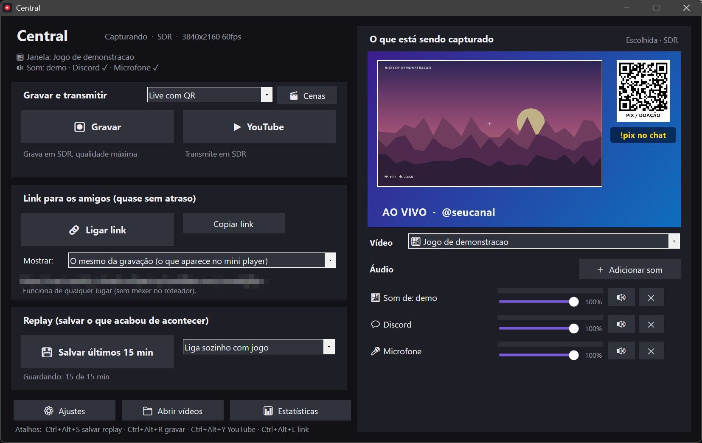
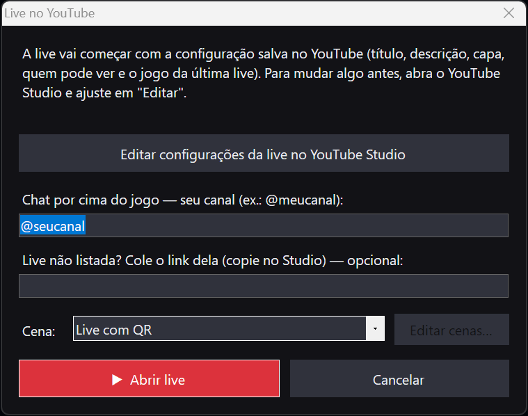
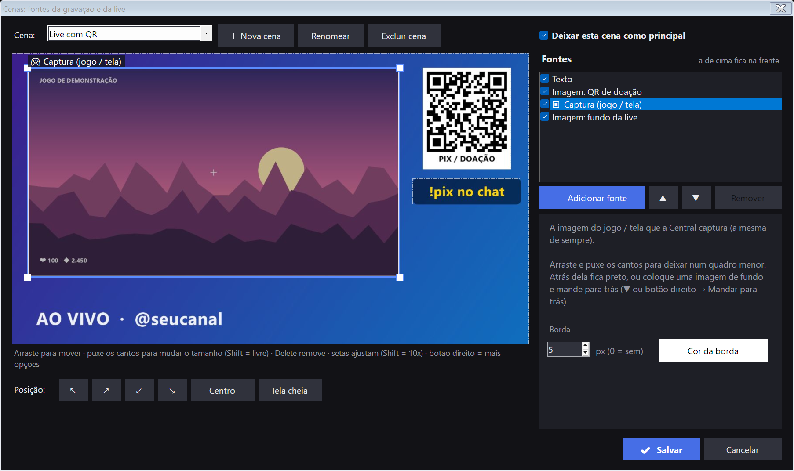
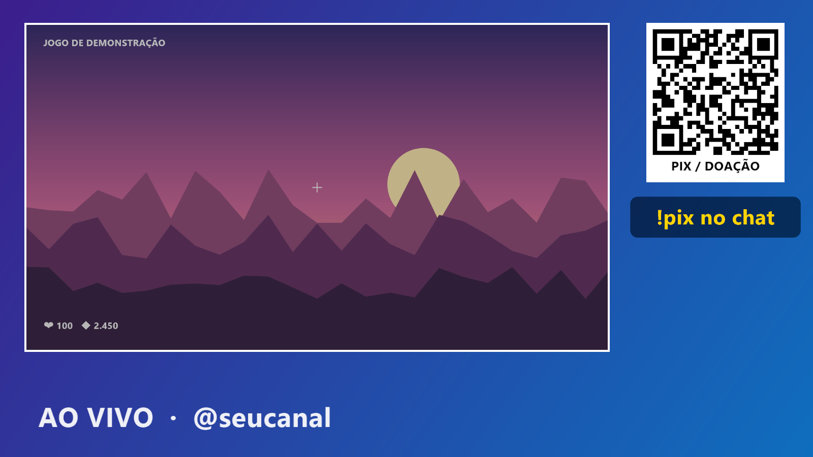
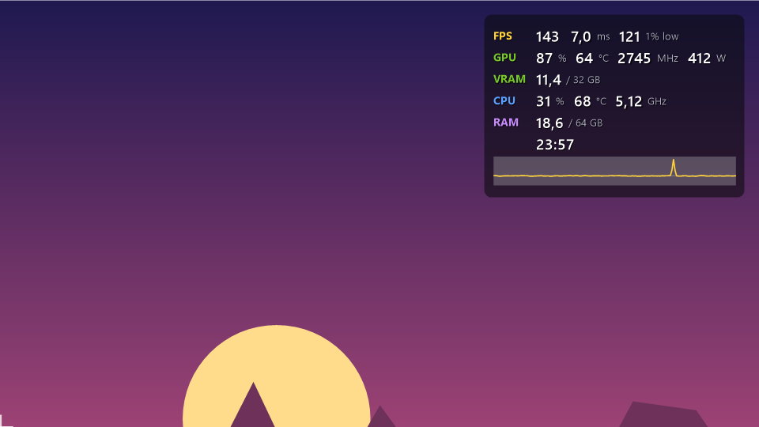

# Central

Programa para quem joga no PC, tudo numa janela só:

- **Grava** os jogos em até 4K HDR, com a qualidade máxima da sua placa de vídeo.
- **Replay**: guarda sempre os últimos minutos. Aconteceu algo legal? Um atalho salva.
- **Live no YouTube** (até 4K HDR), com o **chat por cima do jogo**.
- **Link para os amigos** assistirem quase sem atraso, de qualquer lugar, sem instalar nada.
- **Cenas**, como no OBS: face cam, QR de doação, logo, textos, o jogo num quadro menor com um fundo atrás.
- **Overlay de estatísticas** por cima do jogo (FPS, frametime, GPU, CPU, temperaturas, RAM, VRAM), no estilo
  do MSI Afterburner/RivaTuner.

> Versão de teste. Se achar qualquer problema, avisa (veja "Como relatar um problema" lá embaixo).

## Requisitos

- Windows 10 ou 11, 64 bits.
- Placa de vídeo NVIDIA (melhor), AMD ou Intel. Sem placa compatível, grava pelo processador (só SDR e até Full HD).
- Uns 1,5 GB livres no disco do Windows, mais o espaço dos vídeos e do replay.
- Webcam (opcional), para a face cam.

## Como instalar

1. Baixe o **CentralSetup.exe** (em **Releases**, aqui ao lado). Tem uns 180 MB.
2. Abra. Como o programa não tem assinatura digital, o Windows mostra **"O Windows protegeu o computador"**:
   clique em **Mais informações → Executar assim mesmo**.
3. Clique em **Instalar**. Ele instala em `AppData\Local\Programs\Central`, cria atalho no menu Iniciar
   (e na área de trabalho, se quiser) e aparece em "Aplicativos instalados" para desinstalar.
4. No fim, o Windows pede **uma permissão** (tela com fundo escuro). É para o overlay de estatísticas:
   - instala o driver **PawnIO** (gratuito, código aberto, assinado), que lê a temperatura do processador;
   - cria uma tarefa do Windows que abre o leitor da temperatura sem perguntar de novo;
   - libera o **FPS** (coloca seu usuário no grupo "Usuários de log de desempenho").

   Se recusar, tudo funciona, menos o FPS e a temperatura do processador no overlay. Para liberar depois, rode o instalador de novo.
5. Para o FPS aparecer, **saia e entre de novo no Windows** (ou reinicie) uma vez.

Tudo o que o programa precisa vai junto (OBS próprio, FFmpeg, servidor do link, runtime do Visual C++): não precisa
instalar mais nada, e o seu OBS normal (se tiver) não é mexido. Atualizar = rodar o instalador novo por cima (os seus
ajustes e cenas ficam).

## Primeiros passos

- A Central abre junto com o Windows, escondida perto do relógio. Clique duas vezes no ícone para abrir.
- Ela **detecta o jogo sozinha**. Em **Vídeo** (à direita) dá para escolher um jogo, uma janela ou a área de trabalho.
- **Atalhos** (funcionam dentro do jogo): `Ctrl+Alt+R` gravar · `Ctrl+Alt+S` salvar replay · `Ctrl+Alt+Y` YouTube ·
  `Ctrl+Alt+L` link · `Ctrl+Alt+O` overlay. Dá para trocar em ⚙ Ajustes (e o do overlay na aba Estatísticas).
- **Controle** (Xbox ou PlayStation): segure **Select/View/Share** e aperte **Y** gravar · **B** replay · **X** print ·
  **A** live · **LB/L1** overlay.
- Os vídeos ficam em `Vídeos\Central` (botão **Abrir vídeos**).
- O manual completo vem junto: `COMO-USAR.md`, na pasta do programa.

## Live no YouTube

Cole a sua **chave de transmissão** em ⚙ Ajustes (YouTube Studio → Criar → Transmitir ao vivo → Stream) uma vez.
Depois é só clicar em **YouTube**: abre esta janelinha, onde dá para ajustar a live no YouTube Studio, informar o seu
canal (para o **chat aparecer por cima do jogo** e na live) e escolher a **cena**.

## Cenas: face cam, QR de doação, overlays (novo)

Por padrão a cena é **Nenhum**: sai só o jogo, como sempre. Se quiser, monte cenas como no OBS e escolha qual usar no
seletor ao lado de "Gravar e transmitir". A cena vale para tudo: gravação, replay, live e link.

O botão **🎬 Cenas** abre o editor:

- **＋ Adicionar fonte**: **imagem / overlay** (QR de doação, logo, moldura, fundo, GIF), **webcam** (face cam),
  **texto** (ex.: "!pix no chat"), **janela de outro programa** ou **vídeo em loop**.
- A **Captura (jogo / tela)** também é uma fonte: dá para deixar o jogo num quadro menor, com um fundo atrás.
- Na prévia: **arraste** para mover, puxe os **cantos** para mudar o tamanho (Shift = livre), **Delete** remove.
  Botão direito: frente/trás, tela cheia, centralizar. Borda com cor e espessura em qualquer fonte (ex.: moldura da face cam).
- Na lista: a de cima fica na frente, a caixinha mostra/esconde.
- **✔ Salvar** grava. Marque **"Deixar esta cena como principal"** para ela já ficar escolhida.

Com a cena do exemplo acima, a live fica assim:

## Overlay de estatísticas

Aba **📊 Estatísticas**: perfis Mínimo, Médio, Máximo ou Personalizado, posição, tamanho e se aparece também no
vídeo/live. Liga e desliga com `Ctrl+Alt+O` ou **Select + LB** no controle. Não injeta nada no jogo (sem risco com anti-cheat).

*(números de exemplo, sobre um jogo de demonstração)*

## Link para os amigos

Clique em **Ligar link** e mande o endereço: abre no navegador do PC ou do celular, sem instalar nada, quase sem atraso.
Na primeira vez, o Windows pergunta se a Central pode receber conexões: clique em **Permitir**. O endereço muda a cada
vez que a Central abre, e só funciona enquanto o link está ligado.

## O que testar (ajuda muito!)

- Gravar e salvar replay num jogo.
- Live no YouTube e o link para os amigos.
- Cenas: face cam, imagem (QR/logo), texto, o jogo num quadro menor; e voltar para "Nenhum".
- Overlay de estatísticas: liga/desliga pelo atalho e pelo controle, perfis, posição, e a opção "No vídeo".
- Atalhos de teclado e do controle dentro do jogo.
- Tela cheia, sem bordas, monitor HDR, mais de um monitor, TV pelo Steam Big Picture.

## Como relatar um problema

Conte **o que fez, o que esperava e o que aconteceu**, e mande junto:

- o arquivo de registro: `%LOCALAPPDATA%\Programs\Central\dados\central.log`
  (cole esse caminho na barra do Explorador de Arquivos);
- sua placa de vídeo, processador e versão do Windows;
- um print, se for algo na tela.

**Não mande** os outros arquivos da pasta `dados`: eles têm a sua chave do YouTube e senhas.

## Desinstalar

Configurações → Aplicativos → Aplicativos instalados → **Central** → Desinstalar. Os vídeos salvos ficam.
O driver PawnIO fica (outros programas também usam); para tirar, desinstale **PawnIO** na mesma lista.

## Programas que vão junto

OBS Studio (GPL-2.0), MediaMTX (MIT), cloudflared (Apache-2.0), FFmpeg (GPL, build do Gyan), PresentMon da Intel (MIT),
driver PawnIO e módulos da LibreHardwareMonitorLib (MPL-2.0). Licenças e links do código: nas pastas `bin\` de cada um
(`bin\sensores\LEIA-ME.txt` para o PawnIO) e em https://github.com/cloudflare/cloudflared para o cloudflared.
